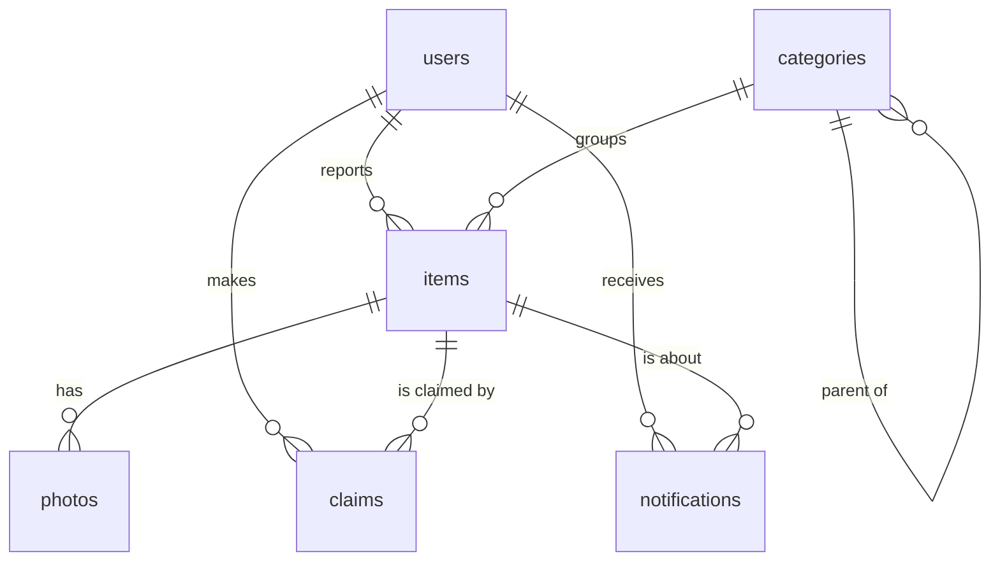

# Found in AUI

A lost and found website for Al Akhawayn University. Students report what they lost or found,
and the database matches lost and found reports **by meaning**, not by exact words: "black
wireless earbuds" can match "AirPods case" even though they share no word. When a likely
match is posted, a PostgreSQL trigger notifies the owner automatically.

Built with Node.js, Express, PostgreSQL and pgvector. The embeddings come from a small
sentence-embedding model (all-MiniLM-L6-v2) that runs locally, with no API key.


## Results

The evaluation uses 40 objects, each described twice in different words: once by the owner
who lost it and once by the person who found it ([data/eval-pairs.json](data/eval-pairs.json)).
Every lost description is searched among the 40 found items, once with PostgreSQL full-text
search and once with embeddings. It also measures the automatic notifications at different
distance thresholds.

- Searching by meaning put the right item first for 37 of 40 lost items (93%), against 26 of 40 (65%) for keyword search. The right item was always in the top 3 (40 of 40), against 33 of 40 (83%).
- The two descriptions of the same object were close (median cosine distance 0.34) and descriptions of different objects were far apart (0.77).
- The notification threshold is a trade-off. At 0.45, the value the trigger uses, it sent 44 notifications and 32 were right (73% precision), and 32 of 40 owners heard about their item (80% recall). A lower threshold sends fewer but more accurate notifications, a higher one reaches more owners with more wrong ones.

### Search

| search | right item first | right item in top 3 | no result at all |
|---|---|---|---|
| keyword (full-text search) | 26/40 (65%) | 33/40 (83%) | 0 |
| semantic (embeddings) | 37/40 (93%) | 40/40 (100%) | 0 |

### Automatic match notifications

For each threshold: how many notifications the trigger would send, how many point to the right item (precision), and how many owners hear about their item (recall).

| max distance | notifications | right ones (precision) | owners notified (recall) |
|---|---|---|---|
| 0.35 | 23 | 23 (100%) | 23/40 (58%) |
| 0.4 | 31 | 27 (87%) | 27/40 (68%) |
| 0.45 | 44 | 32 (73%) | 32/40 (80%) |
| 0.5 | 56 | 36 (64%) | 36/40 (90%) |
| 0.55 | 74 | 37 (50%) | 37/40 (93%) |
| 0.6 | 120 | 38 (32%) | 38/40 (95%) |
| 0.65 | 165 | 39 (24%) | 39/40 (98%) |

Run it yourself with `npm run evaluate`. The full output is in [results/evaluation.md](results/evaluation.md).

## How it works

```
browser (public/*.html)
   |  fetch /api/...
   v
Express server (src/)
   |  1. a new item's title + description -> 384-number embedding (src/embeddings.js)
   |  2. INSERT INTO items (..., embedding)
   v
PostgreSQL + pgvector
      triggers (db/triggers.sql) check the rules and create the notifications
```

**Matching.** Each item stores an embedding of its title and description in a `vector(384)`
column. When a found item is inserted, the trigger `notify_possible_matches` looks for open
lost items whose embedding is close (cosine distance below 0.45, pgvector's `<=>` operator)
and that were lost before the found date, and notifies their owners. Reporting a lost item
works the other way around.

**Search.** The search page has two modes. *Meaning* compares the embedding of the search text
with every item. *Keywords* uses PostgreSQL full-text search (`to_tsvector` / `ts_rank`).
Category filters include subcategories, using a recursive SQL function (`category_tree`).

**Claims.** To get a found item back, the owner claims it with a detail only they would know.
The finder approves or rejects it. An approved claim marks the item as claimed and sends the
finder's email to the owner.

## Database



Business rules and where they are enforced:

| Rule | How |
|---|---|
| only AUI members can sign up | `CHECK (email LIKE '%@aui.ma')` on users |
| an item has only one active claim | partial unique index `one_active_claim_per_item` on claims, only over pending and approved claims |
| only found, open items can be claimed, never by their finder | trigger `check_new_claim` |
| status goes open -> claimed -> returned, never back from returned | trigger `check_status_change` |
| the finder is told about new claims, the claimant about the decision | triggers `notify_finder_of_claim` and `apply_claim_decision` |
| owners hear about items that may be theirs | trigger `notify_possible_matches` |

Decisions worth explaining:

- **Lost and found items share one table** with a `kind` column. They have the same
  attributes, and matching means comparing the two kinds, which is one self-join.
- **Rules live in the database, not only in the API.** Anything that writes to the database
  (the API, a script, a person in psql) has to follow them.
- **The embedding is computed in Node before the INSERT**, so the trigger can use it in the
  same transaction.
- **Passwords are hashed with bcrypt**, and the finder's email is only shared after they
  approve a claim.

## Run it

You need Node.js 20 or newer and Docker (Docker Desktop on Windows and Mac).

```bash
cp .env.example .env          # database settings and session secret (Windows: copy .env.example .env)
docker compose up -d          # PostgreSQL + pgvector on port 5433
npm install
npm run db:seed               # creates the tables and adds demo data
npm start                     # http://localhost:3000
```

The first `npm run db:seed` downloads the embedding model (about 25 MB). Demo accounts: `y.benali@aui.ma`,
`o.tazi@aui.ma`, `s.idrissi@aui.ma`, `k.alaoui@aui.ma` and `h.amrani@aui.ma`, all with the
password `demo1234`. For example, log in as h.amrani@aui.ma to answer the claim on the
earbuds.

Other commands:

```bash
npm test             # database rules (constraints and triggers), on a separate test database
npm run evaluate     # keyword vs semantic search, writes results/evaluation.md
npm run db:setup     # empty tables, no demo data
```

## Files

| Path | What it is |
|---|---|
| `db/schema.sql` | tables, constraints, indexes, views, `category_tree` |
| `db/triggers.sql` | the five triggers |
| `src/server.js` | Express app, error handling |
| `src/routes/` | API routes: auth, items, claims, notifications |
| `src/embeddings.js` | text to embedding with the local model |
| `src/search.js` | keyword search, semantic search, similar items |
| `public/` | the pages (HTML, CSS, plain JavaScript) |
| `scripts/` | database setup, demo data, evaluation |
| `tests/database.test.js` | tests for the database rules |

## Limitations

- The model only understands English well. Descriptions in French or Arabic won't match
  reliably, and a multilingual model would be the next step for AUI.
- The 0.45 threshold was chosen on the same 40 pairs it is evaluated on, so real-world
  numbers would be a bit lower.
- Notifications are inside the website only, there are no emails.
- Logins are kept in the server's memory, so restarting the server logs everyone out.
- Photos are only displayed, they are not used for matching.

## History

This started as my Spring 2024 project for CSC 3326 Database Systems at AUI: the
requirements, the ER design (users, items, categories, claims, photos, notifications) and the
first HTML pages. That version never had a working backend, and some SQL had bugs (a circular
foreign key between items and claims, a trigger reading from the reserved table name `user`,
no way to store lost items). In 2026 I rebuilt it: fixed schema and triggers, the Express API,
working pages, and embedding-based matching with pgvector.
