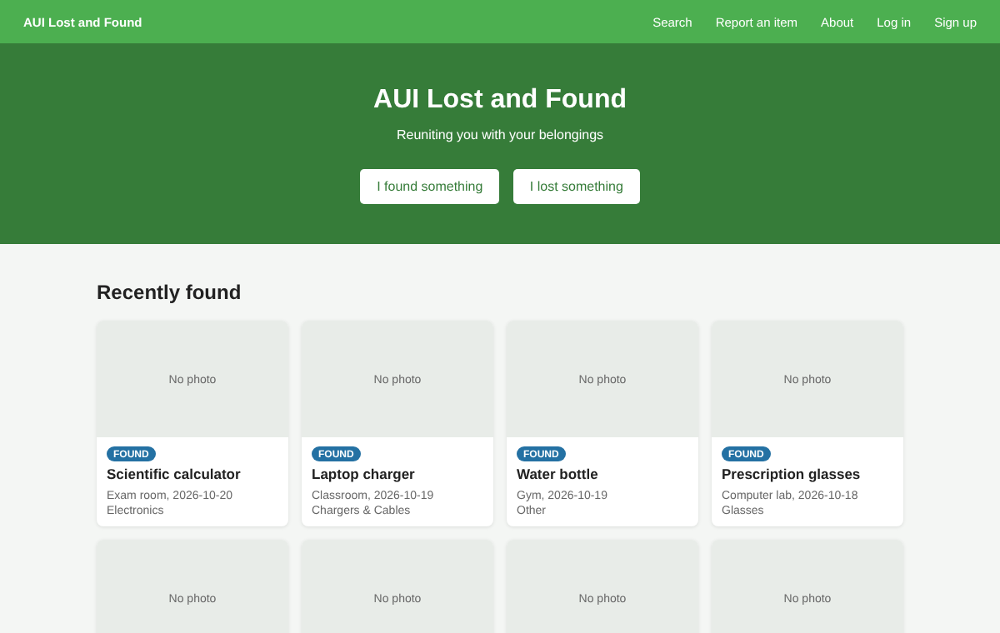
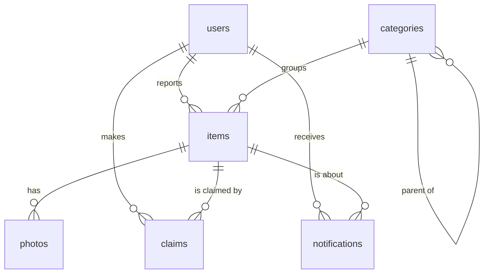

# Found in AUI

A lost and found website for Al Akhawayn University. Students post what they lost or found, and the database matches reports by meaning instead of exact words, so "black wireless earbuds" can match "AirPods case". When a likely match is posted, a PostgreSQL trigger notifies the owner.

Stack: Node.js, Express, PostgreSQL with pgvector, and a small local sentence-embedding model (all-MiniLM-L6-v2, no API key).



## How it works

Each item stores a 384-number embedding of its title and description in a `vector(384)` column. The embedding is computed in Node before the insert, so the trigger can use it in the same transaction.

- **Matching:** when a found item is inserted, the trigger `notify_possible_matches` looks for open lost items with a cosine distance below 0.45 that were lost before the found date, and notifies their owners. Posting a lost item works the other way around.
- **Search:** the search page has a meaning mode (embeddings) and a keyword mode (PostgreSQL full-text search). Category filters include subcategories through a recursive function, `category_tree`.
- **Claims:** the owner claims a found item with a detail only they would know. The finder approves or rejects it, and the finder's email is shared only after approval.

The business rules live in the database, so anything that writes to it (the API, a script, psql) has to follow them: AUI emails only, one active claim per item, no claiming your own item, and a status that only moves open, claimed, returned. Lost and found items share one table with a `kind` column, which makes matching a single self-join.



## Results

I wrote 40 objects, each described twice in different words, once as lost and once as found ([data/eval-pairs.json](data/eval-pairs.json)). Every lost description is searched among the 40 found items.

| Search | Right item first | In top 3 |
|---|---|---|
| Keyword (full-text) | 26/40 (65%) | 33/40 (83%) |
| Semantic (embeddings) | 37/40 (93%) | 40/40 (100%) |

The median cosine distance is 0.34 between two descriptions of the same object and 0.77 between different objects.

The trigger threshold is a trade-off between precision (how many notifications are right) and recall (how many owners hear about their item):

| Max distance | Notifications | Precision | Recall |
|---|---|---|---|
| 0.35 | 23 | 100% | 58% |
| 0.45 (used) | 44 | 73% | 80% |
| 0.55 | 74 | 50% | 93% |
| 0.65 | 165 | 24% | 98% |

The full table is in [results/evaluation.md](results/evaluation.md). Run `npm run evaluate` to reproduce it.

## Getting started

You need Node.js 20 or newer and Docker.

```bash
cp .env.example .env     # on Windows: copy .env.example .env
docker compose up -d     # PostgreSQL with pgvector on port 5433
npm install
npm run db:seed          # creates the tables and adds demo data
npm start                # http://localhost:3000
```

The first seed downloads the embedding model (about 25 MB). Demo accounts such as `h.amrani@aui.ma` all use the password `demo1234`.

Other commands:

```bash
npm test                 # constraints and triggers, on a separate test database
npm run evaluate         # keyword vs semantic search, writes results/evaluation.md
npm run db:setup         # empty tables, no demo data
```

## Project layout

```
db/         schema.sql, triggers.sql
src/        server.js, db.js, embeddings.js, search.js, routes/
public/     the pages (HTML, CSS, plain JavaScript)
scripts/    setup-db.js, seed.js, evaluate.js
tests/      database.test.js
```

## Limitations

- The model handles English well. French or Arabic descriptions won't match reliably, so a multilingual model is the obvious next step.
- The 0.45 threshold was picked on the same 40 pairs it is evaluated on, so real numbers would be somewhat lower.
- Notifications appear only on the website, there are no emails.
- Sessions are kept in server memory, so a restart logs everyone out.
- Photos are displayed but not used for matching.

## Background

This began as my Spring 2024 database course project at AUI: the requirements, the ER design and the first HTML pages, without a working backend. In 2026 I rebuilt it with a fixed schema and triggers, the Express API, working pages and embedding-based matching.
